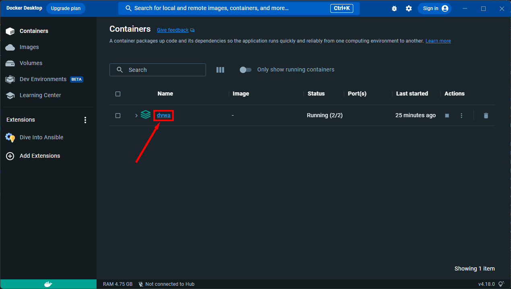
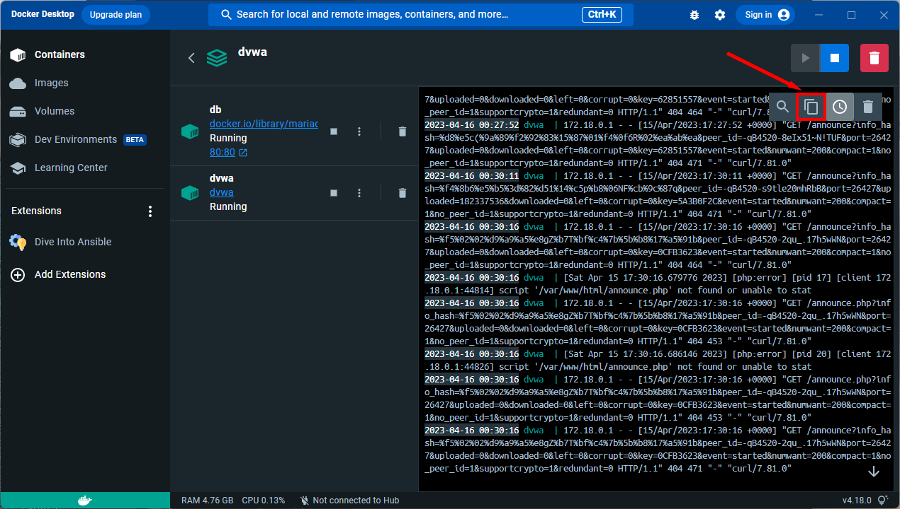

# Auditoria controlada de senhas com Kali Linux e Medusa

Material didático para estudar autenticação fraca, auditoria autorizada e mitigação em um laboratório isolado. O roteiro acompanha os tópicos da imagem de referência e usa Kali Linux, Metasploitable 2 e DVWA.

> [!CAUTION]
> Faça os exercícios somente em máquinas virtuais suas, em rede **host-only/interna**, ou em sistemas para os quais exista autorização escrita. Metasploitable 2 e DVWA são intencionalmente vulneráveis. Não conecte os alvos à rede da empresa, à rede pública ou à Internet. Os arquivos deste repositório contêm apenas nomes e senhas sintéticos para laboratório.

## Objetivos

- Entender diferenças entre força bruta, ataque de dicionário, password spraying e credential stuffing.
- Observar, em pequena escala e com contas fictícias, como tentativas de autenticação afetam FTP, formulários Web e SMB.
- Usar o Medusa e conhecer Hydra, Ncrack, John the Ripper, WPScan, Patator, Nmap e `smbclient`.
- Identificar configurações frágeis e propor controles verificáveis.

## Escopo e regras do laboratório

1. Antes de iniciar, confirme que Kali e Metasploitable 2 estão em uma rede virtual **host-only** ou **interna**, sem adaptador em modo bridge. Mantenha a máquina vulnerável desligada quando não estiver em uso.
2. Use um endereço IP individual da VM que você acabou de iniciar. O endereço `192.168.56.101` nos exemplos é ilustrativo; confirme o endereço real na sua rede host-only antes de executar qualquer comando.
3. Use somente os arquivos sintéticos deste repositório e contas criadas para o exercício. Não use credenciais de pessoas, de organizações, vazadas ou reutilizadas.
4. Limite cada exercício aos poucos registros fornecidos, a um serviço e a uma VM. Use uma thread, observe os logs e pare ao encontrar uma credencial válida.
5. Não tente contornar bloqueios, limites, MFA, monitoramento ou controles de acesso. Se um serviço não estiver disponível ou o comportamento diferir, encerre e ajuste o laboratório.
6. Não publique evidências com endereços, nomes, hashes ou credenciais reais.

## Índice

1. [Introdução](#introdução)
2. [Principais tipos de ataques](#principais-tipos-de-ataques)
3. [Password spraying e credential stuffing](#password-spraying-e-credential-stuffing)
4. [Hydra no Kali Linux](#hydra-no-kali-linux)
5. [Ncrack no Kali Linux](#ncrack-no-kali-linux)
6. [John no Kali Linux](#john-no-kali-linux)
7. [WPScan no Kali Linux](#wpscan-no-kali-linux)
8. [Patator no Kali Linux](#patator-no-kali-linux)
9. [Ambiente com Kali Linux e Metasploitable 2](#ambiente-com-kali-linux-e-metasploitable-2)
10. [Alcançando a máquina vulnerável no Metasploitable 2](#alcançando-a-máquina-vulnerável-no-metasploitable-2)
11. [Criando arquivos de usuários e senhas comuns](#criando-arquivos-de-usuários-e-senhas-comuns)
12. [Ataques de força bruta em formulários de login Web](#ataques-de-força-bruta-em-formulários-de-login-web)
13. [Criação de wordlists](#criação-de-wordlists)
14. [Utilizando o Medusa para simular combinações de acesso](#utilizando-o-medusa-para-simular-combinações-de-acesso)
15. [Ataque em cadeia: enumeração SMB e password spraying](#ataque-em-cadeia-enumeração-smb-e-password-spraying)
16. [Simulando um cenário corporativo mal configurado](#simulando-um-cenário-corporativo-mal-configurado)
17. [Criando uma lista de usuários](#criando-uma-lista-de-usuários)
18. [Testando o acesso utilizando smbclient](#testando-o-acesso-utilizando-smbclient)
19. [Vulnerabilidades comuns e medidas de mitigação](#vulnerabilidades-comuns-e-medidas-de-mitigação)
20. [Modelo de relatório](#modelo-de-relatório)
21. [Fontes oficiais](#fontes-oficiais)

## Introdução

Uma auditoria de autenticação verifica se os controles de login resistem a tentativas previsíveis e se a equipe consegue perceber e responder a essas tentativas. O objetivo deste laboratório é observar o comportamento e registrar recomendações; não é obter acesso a sistemas alheios.

O **Medusa** é um auditor modular de logins de rede. Seus módulos tratam protocolos diferentes, como FTP, SMB e HTTP. O número de tentativas cresce com a quantidade de usuários, senhas e alvos, por isso os exemplos aqui ficam limitados a uma VM, uma thread e listas de poucos itens. Consulte `medusa -d` para ver os módulos instalados e `medusa -M <módulo> -q` para ler as opções de um módulo disponível.

## Principais tipos de ataques

| Técnica | Como funciona | O que observar na auditoria |
|---|---|---|
| Força bruta | Testa combinações de caracteres até encontrar uma senha correspondente. | Limites de tentativas, duração, alertas e bloqueio de conta. |
| Ataque de dicionário | Testa uma lista pequena de palavras ou senhas de teste. | Senhas fracas, padrões previsíveis e resposta do serviço. |
| Password spraying | Testa uma senha candidata em várias contas, em vez de várias senhas em uma conta. | Política global, bloqueios, MFA, alertas e contas com senha compartilhada. |
| Credential stuffing | Reutiliza pares usuário/senha obtidos de outro contexto. | Reutilização de senha, MFA, detecção de logins anômalos e processo de resposta. Neste laboratório, use somente pares sintéticos. |
| Auditoria offline de hashes | Compara hashes de um conjunto autorizado com candidatos locais, sem autenticar no serviço. | Algoritmo, salt, custo de derivação e armazenamento seguro. Nunca extraia hashes de máquinas sem autorização. |

## Password spraying e credential stuffing

No password spraying, uma lista de usuários é combinada com uma única senha de laboratório; a intenção é medir controles, não evitar alertas ou bloqueios. O arquivo `data/usuarios-lab.txt` contém três identidades fictícias. Faça a demonstração somente na VM isolada, com uma senha de teste, uma thread e observação dos logs.

Credential stuffing é diferente: são tentadas combinações usuário/senha já associadas entre si. `data/combinacoes-lab.txt` contém apenas dois pares artificiais e usa o formato de combinação aceito pelo Medusa. Com a VM e uma conta FTP sintética preparadas, a simulação fica restrita a esses pares:

```bash
medusa -h "$ALVO" -C data/combinacoes-lab.txt -M ftp -t 1 -f -v 4
```

Não acrescente dados de vazamentos ou credenciais de terceiros.

## Hydra no Kali Linux

Hydra é uma ferramenta de auditoria de autenticação em serviços de rede, incluindo FTP, formulários HTTP e SMB. Para conhecer a instalação e as opções sem gerar tráfego, consulte `hydra -h` e a documentação do pacote Kali. Em uma avaliação autorizada, defina previamente serviço, host, conta de teste, limite de tentativas e janela de execução. Não use listas externas nem varreduras de múltiplos hosts neste exercício.

## Ncrack no Kali Linux

Ncrack audita a autenticação de serviços de rede e pode testar vários hosts em paralelo. Essa capacidade pode gerar muitas tentativas rapidamente; neste roteiro, conheça a ferramenta com `ncrack --help` e não use uma lista de hosts. Para qualquer avaliação prática, mantenha um único alvo de laboratório e uma lista mínima aprovada.

## John no Kali Linux

John the Ripper audita hashes de senha **offline**; ele não é um cliente para tentar logins em FTP, Web ou SMB. Use-o apenas sobre hashes sintéticos ou fornecidos com autorização explícita. O repositório não inclui hashes coletados de sistemas nem comandos para extraí-los. Uma recomendação defensiva é armazenar senhas com um algoritmo moderno de derivação, salt individual e fator de trabalho adequado.

## WPScan no Kali Linux

WPScan é um scanner de segurança para WordPress. Ele pode ajudar a identificar versões e componentes desatualizados em uma instalação própria; não é o scanner apropriado para DVWA, que não é WordPress. Para este estudo, limite qualquer inspeção a uma instância WordPress de laboratório, sem enumerar sites públicos ou testar senhas de usuários.

## Patator no Kali Linux

Patator é um framework modular de testes de autenticação e protocolo. A flexibilidade de seus módulos também pode causar carga elevada. Use `patator -h` para conhecer os módulos instalados e, se houver teste autorizado, documente serviço, escopo, conta fictícia, volume máximo e condição de parada antes de executá-lo.

## Ambiente com Kali Linux e Metasploitable 2

### Topologia sugerida

```text
┌───────────────────────────────┐      rede host-only/interna      ┌──────────────────────────────┐
│ Kali Linux                    │ ◄────────────────────────────────► │ Metasploitable 2             │
│ Nmap, Medusa, smbclient        │                                    │ FTP/SMB para estudo isolado  │
└───────────────────────────────┘                                    └──────────────────────────────┘

Navegador no Kali ── 127.0.0.1:4280 ── DVWA local em contêiner
```

1. Crie as VMs em um hipervisor local e conecte as interfaces de laboratório somente a uma rede host-only/interna.
2. Não use bridge para a VM vulnerável. Não encaminhe portas do roteador nem exponha os serviços da VM para a LAN.
3. Baixe Metasploitable 2 somente da página indicada pela documentação da Rapid7. Tire um snapshot antes do exercício.
4. Para a parte Web, use `compose.yaml` deste repositório. A publicação de porta está vinculada a `127.0.0.1`, então o DVWA fica acessível somente pela própria máquina que executa o contêiner.

Capturas do guia oficial do DVWA mostram onde acompanhar o contêiner e seus logs:





Instale apenas os utilitários necessários no Kali:

```bash
sudo apt update
sudo apt install -y medusa nmap smbclient hydra ncrack john wpscan patator
```

Suba o DVWA local e acesse `http://127.0.0.1:4280`:

```bash
docker compose up -d
```

Finalize a atividade e pare os contêineres:

```bash
docker compose down
```

O DVWA foi criado intencionalmente para estudo de segurança e deve permanecer em loopback. A rede Docker do arquivo está marcada como interna, sem conectividade externa. A configuração de banco incluída é apenas para o laboratório; não a reutilize em produção.

## Alcançando a máquina vulnerável no Metasploitable 2

Depois de iniciar a VM, confirme seu endereço IP no console local. A documentação da Rapid7 descreve o uso de `ifconfig` na VM. Na máquina Kali, defina o IP **individual** que você confirmou na interface host-only:

```bash
ALVO=192.168.56.101   # exemplo apenas; substitua pelo IP confirmado da sua VM
nmap -sV -p 21,80,139,445 "$ALVO"
```

Esse inventário consulta somente as portas FTP, HTTP e SMB necessárias para o roteiro. Se o IP não pertencer à sua VM de laboratório, se a rede não estiver isolada ou se o serviço não for esperado, não prossiga. O resultado depende da imagem e das configurações da VM.

## Criando arquivos de usuários e senhas comuns

Os arquivos em `data/` são pequenos e artificiais. Para que um teste tenha resultado, crie no alvo isolado uma conta de laboratório que corresponda aos dados e confirme que ela não tem permissões além das necessárias. Não use as contas padrão do Metasploitable 2 como credenciais de serviço; a senha de console publicada pelo fornecedor serve apenas para entrar na VM de treinamento.

- `data/usuarios-lab.txt`: três nomes fictícios.
- `data/senhas-lab.txt`: três senhas de demonstração, incluindo um exemplo fraco.
- `data/combinacoes-lab.txt`: dois pares de teste para um exercício de credential stuffing simulado.

O arquivo de senhas contém poucos itens de propósito. Não o expanda com dumps, listas vazadas ou dados pessoais.

## Ataques de força bruta em formulários de login Web

Use somente o DVWA local em `http://127.0.0.1:4280`. No DVWA, escolha o módulo educacional de brute force e um nível de segurança de laboratório. Para observar o fluxo com um proxy de teste como Burp Suite Community:

1. Configure o navegador do Kali para enviar tráfego local ao proxy.
2. Capture **uma** requisição de login do DVWA e envie-a ao Repeater para entender campos, cookies e resposta.
3. Compare uma tentativa inválida e uma tentativa com a credencial de teste da própria aplicação. Verifique código HTTP, tamanho da resposta, mensagem, logs e eventuais atrasos.
4. Se o instrutor pedir comparação de candidatos, use apenas os três valores em `data/senhas-lab.txt`, em um único alvo local, sem concorrência e com parada ao primeiro sucesso. Não aplique essa lista a qualquer domínio público.
5. Registre o que a aplicação revela quando o login falha e quais controles estão ausentes. O DVWA é vulnerável por projeto; ele não representa uma configuração segura de produção.

Medusa possui módulo Web Form, mas os parâmetros dependem da forma do formulário, sessão e versão. Consulte `medusa -d`, a documentação do [módulo Web Form](https://jmk-foofus.github.io/medusa/medusa-web-form.html) e as opções do módulo correspondente listado localmente antes de um exercício. Não copie opções de um formulário para outro nem use esse recurso fora do DVWA local.

## Criação de wordlists

Uma wordlist de auditoria deve ser aprovada, pequena, rastreável e sem dados pessoais. Os arquivos fornecidos podem ser revistos manualmente e deduplicados no próprio laboratório:

```bash
sort -u data/senhas-lab.txt -o data/senhas-lab.txt
wc -l data/usuarios-lab.txt data/senhas-lab.txt
```

Para o exercício, explique por que senhas previsíveis e reutilizadas são frágeis; não aumente o volume para acelerar tentativas. Para uma auditoria real, a criação e o uso de candidatos precisam estar descritos no escopo escrito e aprovados pelo responsável pelo sistema.

## Utilizando o Medusa para simular combinações de acesso

Primeiro confira que o Medusa está instalado e quais módulos estão disponíveis:

```bash
medusa -V
medusa -d
```

Exemplo de auditoria de **uma conta fictícia em FTP** na VM isolada. `ALVO` deve ser o IP host-only confirmado; a conta `aluno-lab` deve existir apenas no serviço de teste:

```bash
medusa -h "$ALVO" -u aluno-lab -P data/senhas-lab.txt -M ftp -t 1 -f -v 4
```

`-t 1` limita a uma autenticação concorrente e `-f` interrompe o teste do host ao encontrar uma combinação válida. Não aumente a concorrência nem o tamanho da lista. Para ver as opções sem executar o módulo, consulte `medusa -M ftp -q`.

## Ataque em cadeia: enumeração SMB e password spraying

Faça a enumeração e a verificação de autenticação somente na VM host-only confirmada:

```bash
smbclient -L "//$ALVO" -N
```

Se o alvo tiver contas SMB sintéticas preparadas especificamente para o exercício, faça no máximo um teste de senha por cada um dos três usuários fictícios:

```bash
medusa -h "$ALVO" -U data/usuarios-lab.txt -p 'senha123' -M smbnt -t 1 -v 4
```

O exemplo ilustra password spraying contra três contas de laboratório e uma única senha candidata. Não inclua nomes ou senhas de funcionários, não use lista de domínio e não tente mascarar ou espaçar o tráfego para escapar de controles. A prática deve ser observada pelo responsável pela VM; interrompa se surgirem alertas inesperados ou impacto no serviço. Para entender as opções SMBNT instaladas, consulte `medusa -M smbnt -q`.

## Simulando um cenário corporativo mal configurado

Crie um cenário fictício com apenas três contas de teste e discuta os achados sem conectar à rede corporativa real. A equipe pode marcar cada item como **observado**, **não observado** ou **não testado**:

- senha de demonstração fraca ou compartilhada entre contas;
- FTP sem criptografia em um segmento que deveria ser protegido;
- compartilhamento SMB visível para convidado ou com permissões excessivas;
- contas de teste sem MFA ou sem alertas de login anômalo;
- política de senha e bloqueio ausente ou inconsistente entre serviços;
- eventos de autenticação sem centralização ou retenção suficiente.

Associe cada achado a uma evidência sem segredo, impacto, responsável e recomendação. Não use um ataque para descobrir contas reais. O relatório-modelo em `templates/relatorio.md` ajuda a manter a evidência sanitizada.

## Criando uma lista de usuários

`data/usuarios-lab.txt` já contém três identificadores fictícios, um por linha. Para simular um spray, confirme primeiro que são contas do laboratório e que o número de tentativas está autorizado. A lista nunca deve ser preenchida por enumeração de pessoas ou funcionários.

## Testando o acesso utilizando smbclient

`smbclient` é um cliente para listar e acessar compartilhamentos SMB; ele não é um mecanismo de força bruta. Liste shares sem autenticação apenas para observar a configuração do alvo:

```bash
smbclient -L "//$ALVO" -N
```

Para testar **uma** conta fictícia autorizada, deixe o cliente solicitar a senha de forma interativa para evitar registrá-la no histórico do shell:

```bash
smbclient -L "//$ALVO" -U aluno-lab
```

Se a conta tiver acesso a um compartilhamento de laboratório conhecido, substitua `<compartilhamento>` pelo nome visto na listagem:

```bash
smbclient "//$ALVO/<compartilhamento>" -U aluno-lab
```

Registre se o acesso foi negado ou concedido e quais permissões foram necessárias. Não copie arquivos do alvo nem abra compartilhamentos que não façam parte do exercício.

## Vulnerabilidades comuns e medidas de mitigação

| Fragilidade | Risco | Mitigação a verificar |
|---|---|---|
| Senha curta, previsível ou reutilizada | Adivinhação ou reaproveitamento em outros serviços. | Senhas únicas e longas, gerenciador aprovado, bloqueio de senhas conhecidamente comprometidas e MFA. |
| Sem limite ou monitoramento de tentativas | Tentativas repetidas podem passar despercebidas. | Limitação progressiva por conta e origem, atraso apropriado, alertas e resposta documentada; evite bloqueios que facilitem negação de serviço. |
| Password spraying sem detecção | Uma única senha fraca pode afetar diversas contas. | MFA resistente a phishing quando possível, detecção de falhas distribuídas e análise de risco do login. |
| Reutilização de credenciais | Um par obtido em outro serviço pode abrir novas sessões. | Senhas exclusivas por serviço, MFA e processo de redefinição após exposição. |
| FTP em texto claro | Credenciais e dados podem ser observados no trânsito. | Desativar FTP simples; usar SFTP ou FTPS conforme a necessidade e validar certificados. |
| SMB legado, convidado ou compartilhamentos amplos | Acesso indevido a arquivos e movimento lateral. | Desativar SMBv1, restringir portas 139/445 por segmento, remover convidado, aplicar menor privilégio e exigir assinatura/criptografia quando suportadas. |
| Senha padrão de conta de serviço | Acesso previsível e difícil de rastrear. | Trocar/remover padrões, usar contas nomeadas, segredo gerenciado e rotação controlada. |
| Hashes rápidos ou sem salt | Tentativas offline ficam muito mais baratas. | Usar Argon2id, scrypt, bcrypt ou PBKDF2 com salt individual e parâmetros atualizados. |
| Login Web revela diferenças excessivas | Respostas podem facilitar enumeração de usuários ou credenciais. | Mensagens genéricas, proteção contra automação, MFA, logs e limites adequados. |

Uma auditoria útil registra tanto o resultado quanto o controle que deveria ter interrompido a tentativa. Não armazene a senha encontrada no relatório; registre apenas a existência do achado e faça a redefinição segura da conta de teste.

## Modelo de relatório

Use [`templates/relatorio.md`](templates/relatorio.md) para documentar escopo, observações e mitigação sem registrar segredos. As imagens em [`images/`](images/) ilustram a inicialização local e a visualização de logs do DVWA; as fontes estão em [`images/SOURCES.md`](images/SOURCES.md).

## Fontes oficiais

- [Kali Linux](https://www.kali.org/) e [documentação de metapacotes](https://www.kali.org/docs/general-use/metapackages/)
- [Kali Tools: Medusa](https://www.kali.org/tools/medusa/) e [documentação oficial do Medusa](https://jmk-foofus.github.io/medusa/medusa.html)
- [Repositório oficial do DVWA](https://github.com/digininja/DVWA) e [configuração Docker Compose](https://github.com/digininja/DVWA/blob/master/compose.yml)
- [Metasploitable 2 — documentação da Rapid7](https://docs.rapid7.com/metasploit/metasploitable-2/)
- [Docker Compose — redes internas](https://docs.docker.com/reference/compose-file/networks/#internal)
- [Nmap Reference Guide](https://nmap.org/book/man.html)
- [Kali Tools: Hydra](https://www.kali.org/tools/hydra/), [Ncrack](https://www.kali.org/tools/ncrack/), [John](https://www.kali.org/tools/john/), [WPScan](https://www.kali.org/tools/wpscan/) e [Patator](https://www.kali.org/tools/patator/)
- [Manual do `smbclient`](https://www.samba.org/samba/docs/current/man-html/smbclient.1.html)

## Licença

O conteúdo original deste roteiro e os arquivos de exemplo estão sob a licença MIT; as capturas em `images/` continuam sujeitas aos direitos e termos de seus autores, identificados em `images/SOURCES.md`.
